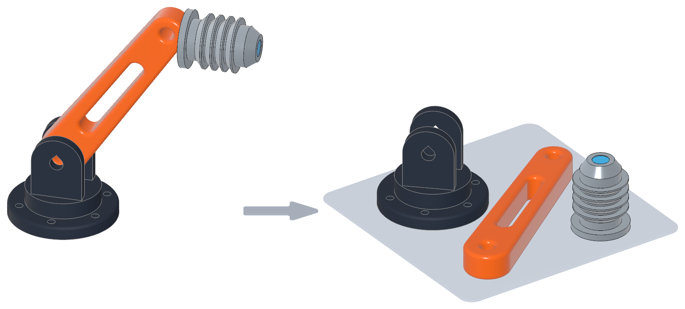

# Prepress

Prepress is a library for [Cadova](https://github.com/tomasf/Cadova) that smooths out the workflow of developing a model for 3D printing.

Writing a model in code makes the model itself easy to change, but the steps around it stay stubbornly manual. Every regeneration means arranging the parts on the bed again, standing up the ones that print on their side, and re-entering the per-object settings you picked last time.

Prepress's goal is to move those steps into code, where each one is expressed once, sits next to the geometry it describes, and stays correct as the design evolves. This is done by per-object slicer settings that travel inside the exported 3MF and apply themselves when the file is opened, and by declaring the printable pieces of a model as *components*, which Prepress orients, multiplies and lays out on a platter. The library is meant to keep growing along those lines, as more of the routine turns out to be worth automating.

## Installation

Integrate Prepress into your project with the Swift Package Manager by adding it as a dependency in your `Package.swift` file:

```swift
.package(url: "https://github.com/tomasf/Prepress.git", .upToNextMinor(from: "0.1.0"))
```

Then, import Prepress where it's needed:

```swift
import Prepress
```

## Usage

### Slicer settings

Per-object print settings can be declared on the geometry they belong to. They're written into the exported 3MF, so opening the file applies them per object with no manual configuration in the slicer. `withSlicerSettings` works on any Cadova part, and on the model's own geometry where there's no part at all, so nothing else in Prepress is needed to use it. List the settings inline, or pass an array where you already have one:

```swift
Box(x: 30, y: 30, z: 10)
    .withSlicerSettings(
        .infill(.gyroid, density: 20),
        .support(.treeAuto),
        .wallCount(4),
    )
    .inPart(name: "Lightweight")
```

The modifier has to be applied *within* the part it configures, as above. Written the other way round (`.inPart(…).withSlicerSettings(…)`) it configures whatever encloses that part, the part around it, or the model's main geometry where there is none, because a part captures its contents where it's declared and anything chained on afterwards lands outside it. Settings declared on a nested part stay with that part and never reach the part around it.

Settings are slicer-agnostic. Each one knows how to express itself in both config formats Prepress writes: Bambu Studio's, also read by OrcaSlicer, Creality Print and the other Bambu-derived slicers, and PrusaSlicer's, also read by SuperSlicer. Both sidecars go into the same file, and each slicer reads the one it knows.

Not every option exists everywhere. A setting with no equivalent in a slicer is simply left out of that slicer's file, so the object keeps whatever the loaded print profile specifies. Nothing is approximated with a neighboring option that means something subtly different. Anything narrower than universal says so in its documentation, for instance **Bambu Studio and its forks only** or **OrcaSlicer only**.

Grouped factories like `infill(_:density:…)`, `support(_:style:…)`, `brim(_:width:…)` and `ironing(_:flow:…)` set several related options at once. Every parameter beyond the first is optional and unspecified ones are *not written*, leaving your own profile's value intact. Single-option factories mix freely with them, refining one value out of a group:

```swift
.withSlicerSettings(
    .infill(.gyroid, density: 20),
    .infillDensity(50),   // wins; the gyroid pattern is kept
)
```

### Components and the platter

The idea is that you build the model as it looks assembled, with each printable piece marked as a component where it sits, and then put the whole assembly on a platter. The assembly stays the one description of the model, and the platter is derived from it: each piece is stood up in its print orientation and laid out flat on the bed.

<p align="center">
  
</p>

A component is a self-contained printable piece. Declare geometry as one with `inComponent`, then call `onPlatter` on the assembly:

```swift
await Model("Bracket set") {
    Box(x: 40, y: 28, z: 10)
        .inComponent(name: "Block")
        .adding {
            Cylinder(bottomDiameter: 30, topDiameter: 10, height: 20)
                .inComponent(name: "Cone")
        }
        .onPlatter()
}
```

Each component is emitted as its own named part, so they stay individually selectable and movable in the slicer. Geometry that isn't a component, including plain Cadova `inPart` parts, is left off the platter rather than dropped onto the bed in an arbitrary orientation.

A component can carry slicer settings for the whole piece, rather than declaring them on the geometry inside it:

```swift
Box(x: 30, y: 30, z: 10)
    .inComponent(name: "Lightweight", settings: .infill(.gyroid, density: 20))
```

Where a part has settings from both, the two are merged, and `withSlicerSettings` wins for any option the component sets as well, being the more specific of the two.

### Orientation

`upDirection` names the direction, in the geometry's own coordinate system, that should point up while printing. A tall pillar modeled standing up but printed lying down says so once, and `onPlatter` tips it flat:

```swift
Box(x: 12, y: 12, z: 70)
    .inComponent(name: "Pillar", upDirection: .right)
```

Declaring a component also sets Cadova's `naturalUpDirection` environment value for its geometry. Anything inside that reads it, such as circular overhang compensation, is then built for the orientation the part is actually printed in, without having to be told the direction a second time.

### Platter options

A component carries a few settings that only mean anything once it's laid out, grouped into `PlatterOptions`.

Each `inComponent` declaration is laid out as its own piece, so four wheels marked with one component around an assembly arrive as four pieces, named after the component and numbered. A single declaration holding several disconnected solids is split the same way by default. Set `separateSolids` to `false` to keep them together as a rigid unit, for a print-in-place hinge or a captive nut:

```swift
hinge
    .inComponent(name: "Hinge", platterOptions: .init(separateSolids: false))
```

`quantity` covers the other case, where the model contains one of something but the print needs several:

```swift
Cylinder(diameter: 26, height: 14).withSegmentation(count: 6)
    .inComponent(name: "Hex", platterOptions: .init(quantity: 4))
```

### Layout

Components are laid out with a no-fit-polygon nester over each one's footprint. The gap between them is the one thing worth tuning:

```swift
.onPlatter()
    .withComponentSpacing(4)  // mm between neighboring parts; defaults to 2
```

`onPlatter` also takes `removingMaterials`, which strips all colors so the platter prints as one uniform material.

Prepress knows nothing about your printer's bed. Each `onPlatter` call lays out one plate as compactly as it can, however large that turns out to be, so the size only becomes a problem once you open the file in a slicer.

### Several platters

When an assembly doesn't fit on one bed, slicers can spread the parts over several plates, but which part lands where can change between runs. To decide for yourself, tag the components and build one platter per model, selecting by tag:

```swift
extension ComponentTag {
    static let wheels = ComponentTag("Wheels")
    static let flexible = ComponentTag("Flexible")
}

// Where the pieces are declared, inside the assembly:
tire.inComponent(name: "Tire", tags: [.wheels, .flexible])
rim.inComponent(name: "Rim", tags: [.wheels])
chassis.inComponent(name: "Chassis")

// Where the platters are built:
await Model("Wheels") {
    Car().onPlatter(only: [.wheels])
}

await Model("The rest") {
    Car().onPlatter(excluding: [.wheels])
}
```

`only` takes components with at least one of the listed tags, and `excluding` leaves out components with any of them. Used together, `excluding` wins. Ending with an `excluding` platter that lists every tag used by the others is a good habit, because a component you add later then lands there instead of never being printed.

A component can have several tags, so overlapping selections can put it on two platters: the tire above would be on both an `only: [.wheels]` and an `only: [.flexible]` platter. Each model is built on its own, so Prepress can't warn about this.

Each component is selected by its own tags. A component nested inside another doesn't inherit its tags, while a plain part declared inside a component follows it. A selection that names a tag no component has, or that leaves the platter empty, prints a warning.

If the pieces of a platter already form a sub-assembly of their own, calling `onPlatter` on just that sub-assembly works too, with no tags needed.

### Assembly view

Flattening a model onto the bed normally throws away the arrangement it started from, leaving a plate of loose parts with nothing recording how they fit together. Prepress writes that arrangement into the 3MF, so Bambu Studio's assembly view can show the model as designed while the plate stays laid out flat.

## License

This project is licensed under the MIT license. See the LICENSE file for details.
